# Class Activity 1 — System Calls in Practice

- **Student Name:** Vutha Daraleap
- **Student ID:** e20230820
- **Date:** 2026-10-28

I did this activity in WSL (Ubuntu) on my own PC. The kernel is `6.18.54.1-microsoft-standard-WSL2`.

---

## Warm-Up: Hello System Call

Screenshot of running `hello_syscall.c` on Linux:

The first time, my prompt appeared on the same line as the message. The text `"Hello, System Call!\n"` is 20 bytes (19 characters plus the newline), so `write(1, message, 19)` left out the `\n`. I changed the count to 20 and the prompt moved to the next line.

Screenshot of running `copyfilesyscall.c` on Linux:

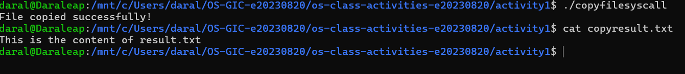

The program printed `File copied successfully!` and `copyresult.txt` has the same text as `result.txt`. I used 26 for the last `write` there, for the same newline reason.

I did not run the Windows example (`hello_winapi.c`), because it is optional.

---

## Task 1: File Creator & Reader

### Part A — File Creator

**Describe your implementation:** The library version needs only three lines of work: `fopen`, `fprintf` and `fclose`. In my system call version I do each step myself. I call `open()` to get a file descriptor, `write(fd, ...)` to put the text in the file, `close(fd)`, and then `write(1, ...)` to print the confirmation to the terminal. I used `strlen()` for the length of each `write()`, so I did not have to count characters by hand. Both versions print the same message and create the same `output.txt`.

**Version A — Library Functions (`file_creator_lib.c`):**

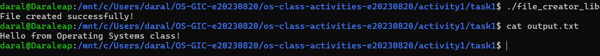

**Version B — POSIX System Calls (`file_creator_sys.c`):**

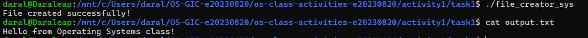

**Questions:**

1. **What flags did you pass to `open()`? What does each flag mean?**

   > I used `O_WRONLY | O_CREAT | O_TRUNC`. `O_WRONLY` opens the file for writing only. `O_CREAT` creates the file if it does not exist. `O_TRUNC` erases the old content if the file already exists, so the file starts empty each time.

2. **What is `0644`? What does each digit represent?**

   > It is the permission mode for a newly created file, written in octal. The first digit after the 0 is for the owner (6 = read 4 + write 2), the second is for the group (4 = read only), and the third is for everyone else (4 = read only). So I can read and write the file, and other users can only read it.

3. **What does `fopen("output.txt", "w")` do internally that you had to do manually?**

   > `fopen` calls `open()` for me with the flags that match `"w"`. In my strace output it shows `openat(..., "output.txt", O_WRONLY|O_CREAT|O_TRUNC, 0666)`. It also creates a `FILE` structure with a buffer in memory, and `fprintf` writes into that buffer. The real `write()` happens when the buffer is flushed by `fclose`. I had to choose the flags and permission (`0644`), keep the file descriptor, call `write()` and call `close()` myself.

### Part B — File Reader & Display

**Describe your implementation:** My system call reader opens `output.txt` with `O_RDONLY`, then reads in a loop into a 256-byte buffer. Each time it writes exactly the bytes that were read to the terminal (file descriptor 1), until `read()` returns 0. Then it closes the file. It prints the same line as the library version.

**Version A — Library Functions (`file_reader_lib.c`):**

**Version B — POSIX System Calls (`file_reader_sys.c`):**

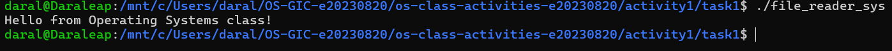

**Questions:**

1. **What does `read()` return? How is this different from `fgets()`?**

   > `read()` returns the number of bytes it actually read, `0` at the end of the file, and `-1` on error. It gives me raw bytes, with no idea of lines. `fgets()` reads one line (up to the newline), puts a string with a terminating `\0` in the buffer, and returns a pointer to the buffer, or NULL at the end of the file.

2. **Why do you need a loop when using `read()`? When does it stop?**

   > One `read()` can return fewer bytes than I asked for, and a file can be bigger than my buffer, so I have to keep calling it. The loop stops when `read()` returns `0`, which means end of file.

---

## Task 2: Directory Listing & File Info

**Describe your implementation:** I kept `opendir()`, `readdir()` and `stat()` the same as the library version. I only replaced `printf` with `snprintf` into a buffer, followed by `write(1, buffer, strlen(buffer))`. The header and every file row go out this way. The table is the same as the library version.

### Version A — Library Functions (`dir_list_lib.c`)

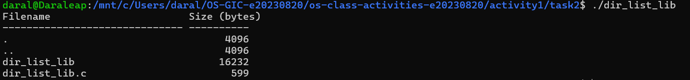

### Version B — System Calls (`dir_list_sys.c`)

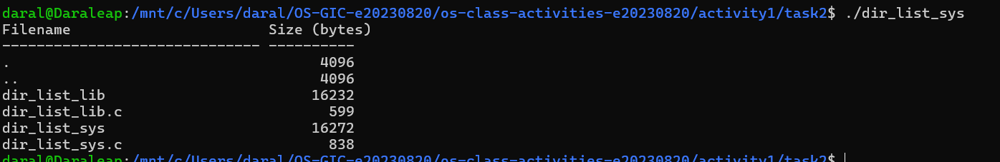

### Questions

1. **What struct does `readdir()` return? What fields does it contain?**

   > It returns a pointer to a `struct dirent` (or NULL at the end). The fields include `d_ino` (inode number), `d_off`, `d_reclen` (record length), `d_type` (file type) and `d_name` (the file name). I used `d_name`.

2. **What information does `stat()` provide beyond file size?**

   > The `struct stat` also has the file type and permissions (`st_mode`), the owner and group IDs (`st_uid`, `st_gid`), the inode number, the number of hard links, the device, the block size and number of blocks, and three timestamps (last access, last modification and last status change).

3. **Why can't you `write()` a number directly — why do you need `snprintf()` first?**

   > `write()` only sends raw bytes. A number such as `4096` is stored in memory as a binary integer, not as the characters `'4' '0' '9' '6'`. If I passed it to `write()`, the terminal would get binary data. `snprintf()` converts the number into text and puts it in a buffer, and then I can write that text.

---

## Optional Bonus: Windows API (`file_creator_win.c`)

Not done.

---

## Task 3: strace Analysis

**Describe what you observed:** The library version made 38 system calls and the system call version made 34 (from `strace -c`). I expected a much bigger difference. The reason is that both programs are normal dynamic programs, so both load `libc.so.6` at startup, and most calls (`execve`, `mmap`, `mprotect`, `openat` for libraries) are the same. In the trace of the file creator, the two lists are almost the same. One thing I noticed is that `fopen` used mode `0666` in `openat`, while my own `open()` used `0644`.

### strace Output — Library Version (File Creator)

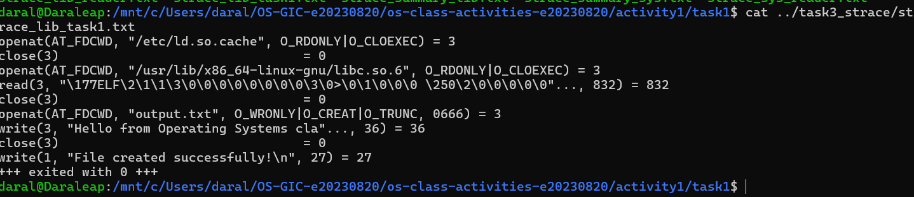

### strace Output — System Call Version (File Creator)

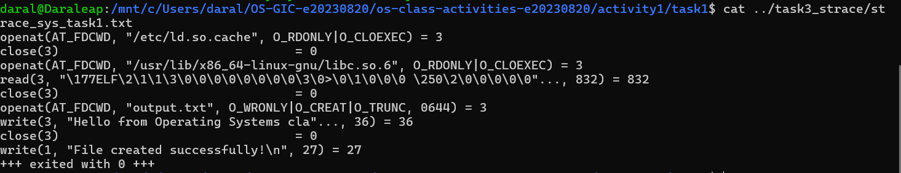

### strace Output — Library Version (File Reader)

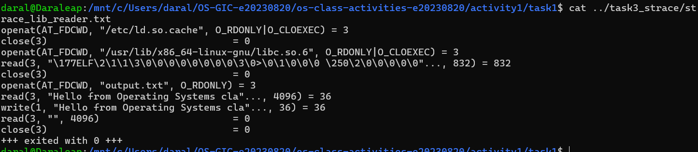

### strace Output — System Call Version (File Reader)

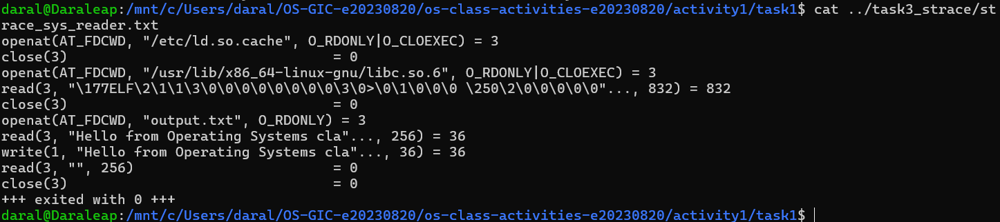

### strace -c Summary Comparison

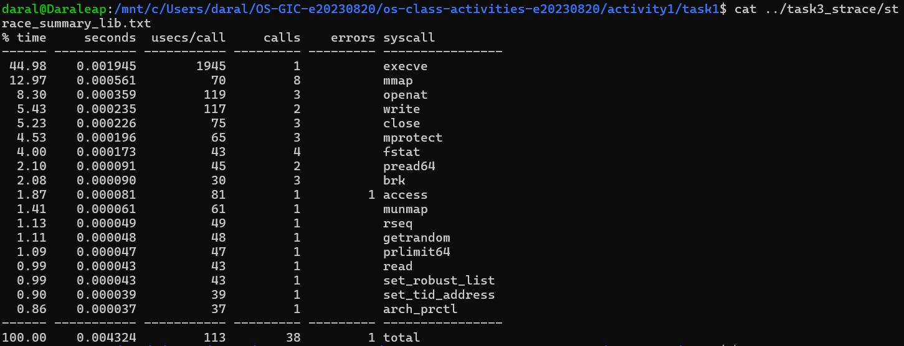
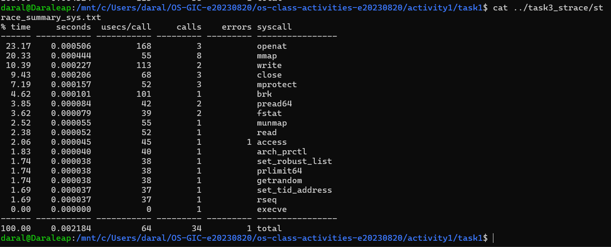

### Questions

1. **How many system calls does the library version make compared to the system call version?**

   > The library version made **38** calls in total and the system call version made **34** (both with 1 error, an `access` call for a file that does not exist). So the library version made 4 more.

2. **What extra system calls appear in the library version? What do they do?**

   > Comparing the two `strace -c` tables, the library version has 2 more `brk` calls (3 against 1) and 2 more `fstat` calls (4 against 2). `brk` moves the end of the heap, which the C library uses to get memory for its own buffers. `fstat` asks the kernel for information about a file, and the library uses it to decide how to buffer the file and the terminal. My own version does not need a buffer, so it skips them.

3. **How many `write()` calls does `fprintf()` actually produce?**

   > Only one. The trace shows a single `write(3, "Hello from Operating Systems cla"..., 36) = 36` for the file. That matches what I expected, because the C library keeps the text in a buffer and sends it to the kernel when the file is closed with `fclose`. The `printf` for the confirmation also gave one `write(1, ..., 27)` to the terminal.

4. **In your own words, what is the real difference between a library function and a system call?**

   > A system call is a request from my program to the kernel, such as `openat`, `write` or `close`, and only the kernel can do these jobs. A library function such as `fopen`, `fprintf` or `printf` is normal code in the C library that runs in my program. It can do extra work like formatting and buffering, and then it makes one or more system calls underneath. In the strace output, `fopen` became `openat`, `fprintf` plus `fclose` became one `write`, and `printf` became another `write`.

---

## Task 4: Exploring OS Structure

### System Information

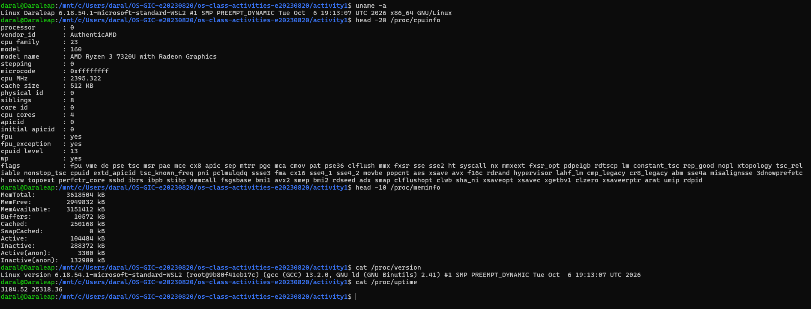

My CPU is an AMD Ryzen 3 7320U with Radeon Graphics, `MemTotal` is 3618504 kB (about 3.5 GB), and the kernel is `6.18.54.1-microsoft-standard-WSL2`.

### Process Information

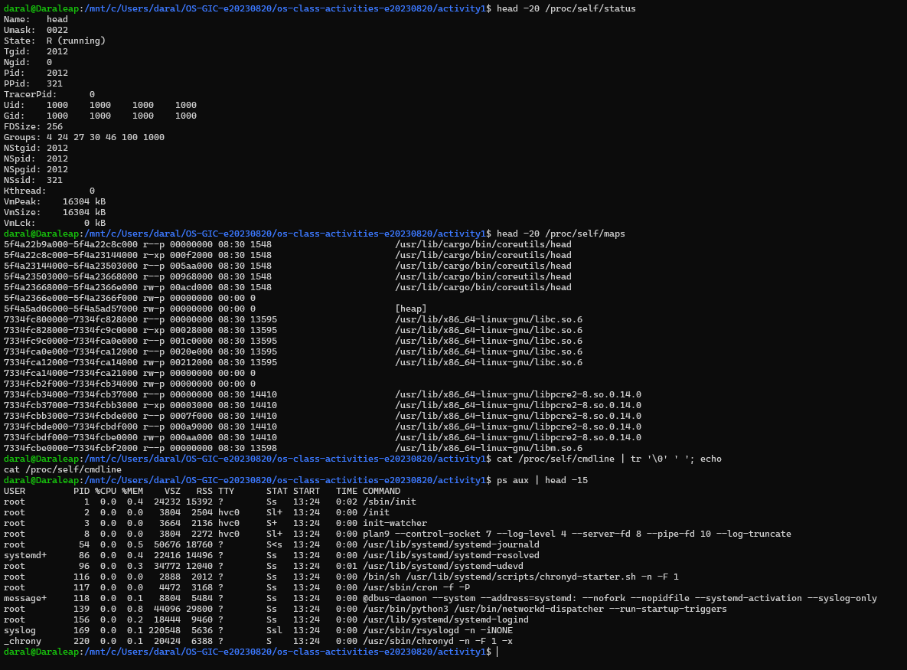

### Kernel Modules

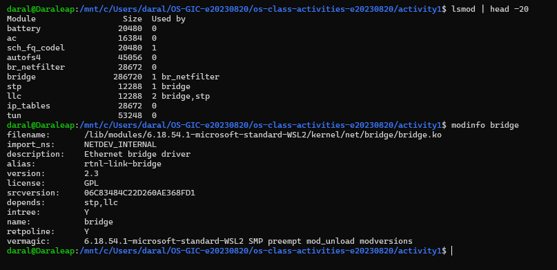

I ran `modinfo bridge`. It is the "Ethernet bridge driver", licence GPL, and it depends on the modules `stp` and `llc`.

### OS Layers Diagram

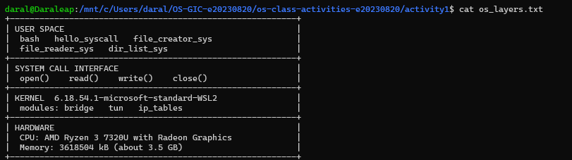

### Questions

1. **What is `/proc`? Is it a real filesystem on disk?**

   > `/proc` is a virtual filesystem. Nothing in it is stored on a disk. The kernel creates the content when I read a file, so it always shows the current state of the system (CPU, memory, processes and so on).

2. **Monolithic kernel vs. microkernel — which type does Linux use?**

   > In a monolithic kernel, most services (drivers, filesystems, networking) run inside the kernel in one program with full privilege. In a microkernel, only a small core runs in kernel mode and the other services run as separate user-space programs that talk by messages. Linux is monolithic. `lsmod` shows modules such as `bridge`, `tun` and `ip_tables` that are loaded into the kernel itself while it runs, so extra features become part of the kernel.

3. **What memory regions do you see in `/proc/self/maps`?**

   > I see the program's own code and data (`/usr/lib/cargo/bin/coreutils/head`, with `r-xp` for code and `rw-p` for data), `[heap]` for dynamic memory, shared libraries (`libc.so.6`, `libpcre2-8.so`, `libm.so.6`), `[vdso]` (a small area the kernel provides so some system calls are fast), and `[stack]` for local variables and function calls.

4. **Break down the kernel version string from `uname -a`.**

   > `Linux Daraleap 6.18.54.1-microsoft-standard-WSL2 #1 SMP PREEMPT_DYNAMIC Tue Oct 6 19:13:07 UTC 2026 x86_64 GNU/Linux`: `Linux` is the kernel name, `Daraleap` is the host name, `6.18.54.1-microsoft-standard-WSL2` is the kernel release (version 6.18.54.1, built by Microsoft for WSL2), `#1` is the build number, `SMP` means it supports several processors, `PREEMPT_DYNAMIC` is the scheduling mode, then comes the build date, `x86_64` is the CPU architecture, and `GNU/Linux` is the operating system.

5. **How does `/proc` show that the OS is an intermediary between programs and hardware?**

   > My commands like `cat` and `head` only read ordinary files. They never touch the CPU or the memory chips directly. The kernel is the one that knows the hardware, and it hands over CPU details, memory size and process information through these files. So the kernel stands between my programs and the hardware.

---

## Reflection

The biggest surprise was that the difference between a library function and a system call is not so big in the strace counts (38 against 34), because both use `libc` anyway. The real difference is in who does the work: `fopen` and `fprintf` hide the `open` and `write` calls and add buffering. Writing the system call versions myself showed me what each step needs (flags, file descriptors, byte counts), and a small mistake such as a wrong byte count in `write()` changes the output.