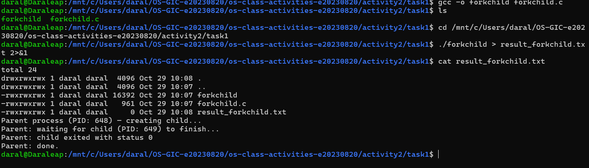
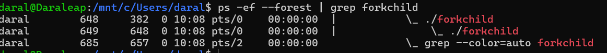
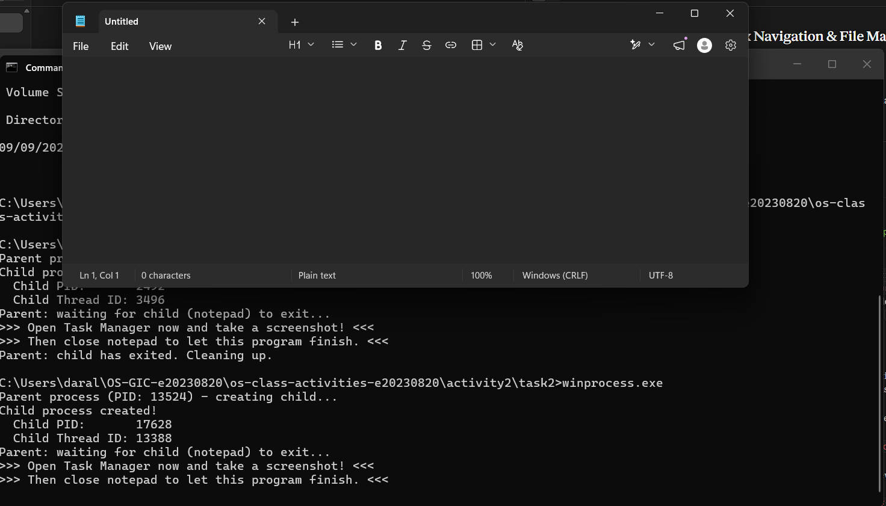
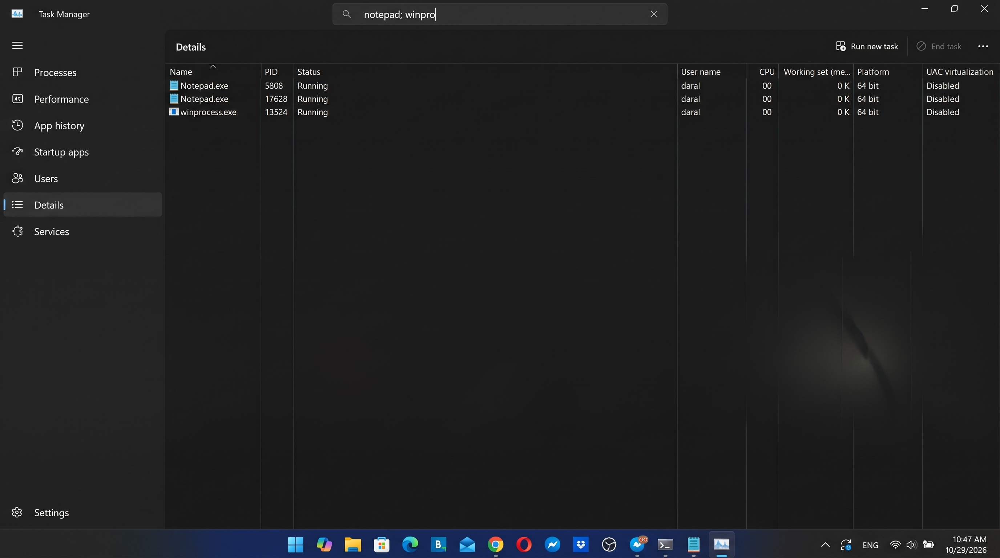
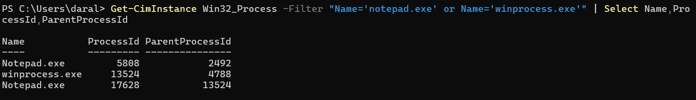
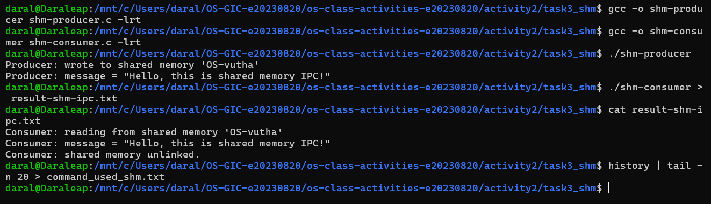
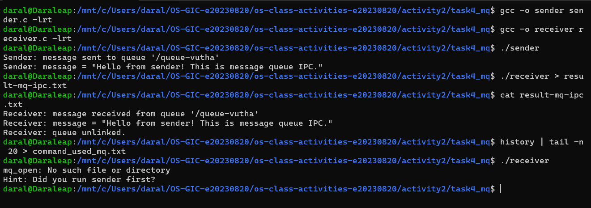

# Class Activity 2 — Processes & Inter-Process Communication

- **Student Name:** Vutha Daraleap
- **Student ID:** e20230820
- **Date:** 2026-10-29

I did Tasks 1, 3 and 4 in WSL (Ubuntu) and Task 2 on Windows. I built `winprocess.exe` from WSL with `x86_64-w64-mingw32-gcc` and ran it in Windows cmd.

---

## Task 1: Process Creation on Linux (fork + exec)

### Compilation & Execution



### Process Tree

I used `ps -ef --forest | grep forkchild` in a second terminal while the child was sleeping:

```
daral  648  382  0 10:08 pts/0  00:00:00  |  \_ ./forkchild
daral  649  648  0 10:08 pts/0  00:00:00  |      \_ ./forkchild
```



### Output

```
total 24
drwxrwxrwx 1 daral daral  4096 Oct 29 10:08 .
drwxrwxrwx 1 daral daral  4096 Oct 29 10:07 ..
-rwxrwxrwx 1 daral daral 16392 Oct 29 10:07 forkchild
-rwxrwxrwx 1 daral daral   961 Oct 29 10:07 forkchild.c
-rwxrwxrwx 1 daral daral     0 Oct 29 10:08 result_forkchild.txt
Parent process (PID: 648) — creating child...
Parent: waiting for child (PID: 649) to finish...
Parent: child exited with status 0
Parent: done.
```

The child's own lines (`Child process (PID: 649...)` and the sleeping message) are not in the file. When the output goes to a file, `printf` keeps its text in a buffer. The child never flushed it, and `execlp()` replaced the program, so the buffered text was lost. The `ls -la` output comes first, because the parent's text is only written when the parent exits.

### Questions

1. **What does `fork()` return to the parent? What does it return to the child?**

   > It returns the child's PID to the parent (649 in my run) and `0` to the child. It returns `-1` if it fails.

2. **What happens if you remove the `waitpid()` call? Why might the output look different?**

   > The parent would not wait. It would print "done" and exit right away, and the shell prompt could come back while the child is still sleeping. The child's output would then appear later, mixed with the prompt. The child would also become an orphan, taken over by the init process, and until the parent collects its exit status, a finished child stays as a zombie.

3. **What does `execlp()` do? Why don't we see "execlp failed" when it succeeds?**

   > `execlp()` replaces the code and data of the current process with a new program (`ls -la`), searching the `PATH`. The process keeps its PID. When it works, the old program is gone, so the next line (`perror("execlp")`) never runs. The line only runs if `execlp()` fails and returns.

4. **Draw the process tree for your program (parent → child). Include PIDs from your output.**

   > ```
   > bash (PID 382)
   >  └── forkchild (PID 648)        parent
   >       └── forkchild (PID 649)   child, PPID = 648
   >            └── becomes "ls -la" after execlp()
   > ```

5. **Which command did you use to view the process tree (`ps --forest`, `pstree`, or `htop`)? What information does each column show?**

   > I used `ps -ef --forest`. The columns are: `UID` (the user, `daral`), `PID` (the process ID), `PPID` (the parent's PID), `C` (CPU use), `STIME` (start time, 10:08), `TTY` (the terminal, `pts/0`), `TIME` (CPU time used) and `CMD` (the command). The child's PPID, 648, is the parent's PID, and the `\_` shows the child under the parent.

---

## Task 2: Process Creation on Windows

I used `notepad.exe` instead of `mspaint.exe`. `where mspaint` found nothing on my PC, and the first run of `CreateProcess` failed with error 2 (file not found). Notepad is always there, so I changed the path in `winprocess.c` to `C:\Windows\System32\notepad.exe`. The rest of the code is the same.

### Compilation & Execution

My program printed: parent PID **13524**, child PID **17628**, child thread ID 13388.



### Task Manager Screenshots

The Details tab shows `winprocess.exe` (PID 13524) and `Notepad.exe` (PID 17628). Another `Notepad.exe` (PID 5808) is left from an earlier test run.



Task Manager has no Parent PID column on my Windows, so I used PowerShell: `Get-CimInstance Win32_Process`. It shows Notepad (17628) with `ParentProcessId` 13524, and `winprocess.exe` (13524) with parent 4788, which is my cmd window.



### Questions

1. **What is the key difference between how Linux creates a process (`fork` + `exec`) and how Windows does it (`CreateProcess`)?**

   > Linux needs two steps: `fork()` makes a copy of the current process, and `exec()` replaces the copy with a new program. Windows does it in one call: `CreateProcess()` creates a new process and loads the program, with no copy of the parent. `CreateProcess()` also takes many parameters, and it gives back handles in a `PROCESS_INFORMATION` structure.

2. **What does `WaitForSingleObject()` do? What is its Linux equivalent?**

   > It blocks the caller until the object, here the child's process handle, is signalled, which happens when the process ends. With `INFINITE` it waits as long as needed. The Linux equivalent is `wait()` or `waitpid()`.

3. **Why do we need to call `CloseHandle()` at the end? What happens if we don't?**

   > The handles to the process and thread are kernel objects that the program holds. If I don't close them, they leak. The kernel keeps the process and thread objects in memory until my program ends, even after the child has exited.

4. **In Task Manager, what was the PID of your parent program and the PID of mspaint? Do they match your program's output?**

   > The parent `winprocess.exe` was PID 13524, and the child (Notepad, since I used it instead of mspaint) was PID 17628. Both match my program's output, and PowerShell shows that the child's parent PID is 13524.

5. **Compare the Processes tab (tree view) and the Details tab (PID/PPID columns). Which view makes it easier to understand the parent-child relationship? Why?**

   > On my Windows, the Processes tab did not show Notepad nested under my program, because Notepad is a Store app and is listed as its own app. The Details tab shows the PIDs but has no Parent PID column. The clearest view was the PowerShell output, which shows `ParentProcessId` directly. A Processes tab tree looks easy to read when it nests, but only a Parent PID column proves the link.

---

## Task 3: Shared Memory IPC

### Compilation & Execution



### Output

```
Consumer: reading from shared memory 'OS-vutha'
Consumer: message = "Hello, this is shared memory IPC!"
Consumer: shared memory unlinked.
```

### Questions

1. **What does `shm_open()` do? How is it different from `open()`?**

   > It creates or opens a named shared memory object and returns a file descriptor for it. `open()` opens a file by its path on the filesystem. A shared memory object is not an ordinary file on disk: it is kept in memory (it appears under `/dev/shm`), and it is found by name, so other processes can open the same object.

2. **What does `mmap()` do? Why is shared memory faster than other IPC methods?**

   > `mmap()` maps the shared memory object into the process's address space, so the program reads and writes it like normal memory through a pointer. Shared memory is faster because, once it is mapped, both processes use the same memory directly. The data is not copied through the kernel for every message, as it is with pipes or message queues.

3. **Why must the shared memory name match between producer and consumer?**

   > The name is how two separate processes find the same object. They share no variables, so if the names are different, each one opens a different object, and the consumer does not see the producer's message.

4. **What does `shm_unlink()` do? What would happen if the consumer didn't call it?**

   > It removes the name of the shared memory object, and the memory is freed when nobody has it mapped. If the consumer didn't call it, the object would stay in the system (in `/dev/shm`) until a reboot, and old data could be found by the next run.

5. **If the consumer runs before the producer, what happens? Try it and describe the error.**

   > I ran `./shm-consumer` before the producer. It printed `shm_open: No such file or directory` and my hint `Did you run shm-producer first?`. The consumer opens the object without `O_CREAT`, so it fails when the producer has not created it yet.

---

## Task 4: Message Queue IPC

### Compilation & Execution

The screenshot also shows what happens when I run `./receiver` with no message queue: `mq_open: No such file or directory` and the hint `Did you run sender first?`.



### Output

```
Receiver: message received from queue '/queue-vutha'
Receiver: message = "Hello from sender! This is message queue IPC."
Receiver: queue unlinked.
```

### Questions

1. **How is a message queue different from shared memory? When would you use one over the other?**

   > A message queue passes separate messages in order (first in, first out) through the kernel. The kernel copies each message, and the receiver gets one whole message at a time. Shared memory is a raw block that both processes read and write directly, with no message boundaries, and the programs must synchronize themselves. I would use a message queue for small commands or events where order matters, and shared memory for large amounts of data that need to be fast.

2. **Why does the queue name in `common.h` need to start with `/`?**

   > The POSIX rule for portable queue names is a single leading slash followed by the name. The name is not a normal file path, but a name in one flat space. The system rejects a name without the `/`.

3. **What does `mq_unlink()` do? What happens if neither the sender nor receiver calls it?**

   > It removes the queue's name, and the queue is destroyed once everyone has closed it. If neither calls it, the queue stays in the system until it is removed or the machine reboots, and unread messages stay inside it.

4. **What happens if you run the receiver before the sender?**

   > `mq_open()` fails, because the queue does not exist. My program printed `mq_open: No such file or directory` and the hint `Did you run sender first?`, and then it exited.

5. **Can multiple senders send to the same queue? Can multiple receivers read from the same queue?**

   > Yes to both. Many senders can put messages in the same queue, and many receivers can read from it. Each message is taken by only one receiver, because reading removes it from the queue. Messages with a higher priority are delivered first, and messages of equal priority come out in order.

---

## Reflection

The most interesting difference was that Linux makes a process in two steps (copy, then replace), while Windows does it in one call. I also learned how easy it is to be surprised by details: buffered output disappeared because of `execlp()`, and Windows 11 Notepad and Task Manager did not show a neat parent and child tree, so I had to use PowerShell to prove it. Of the two IPC methods, I prefer shared memory for speed, but the message queue was simpler to use, because it handles the order and the copying for me.