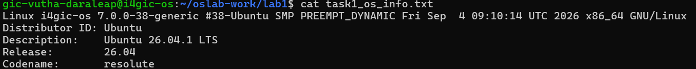
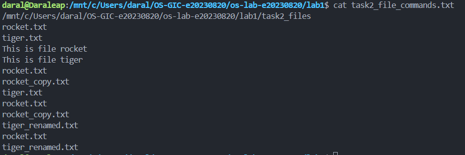
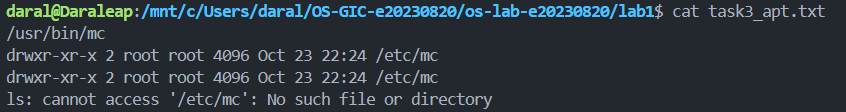
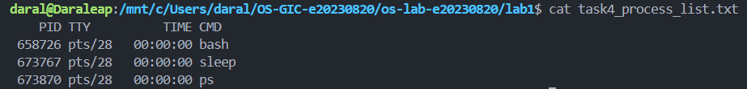
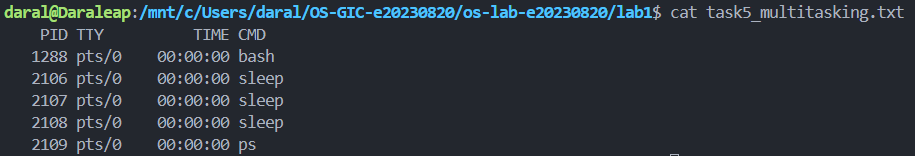
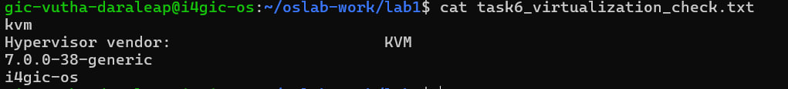

# OS Lab 1 Submission

- **Student Name:** Vutha Daraleap
- **Student ID:** e20230820
- **Ubuntu username on the server:** gic-vutha-daraleap
- **My values** (`oslab values lab1`): file1 = rocket, file2 = tiger, count = 3

---

## Task 1: Operating System Identification

I saved the kernel and distribution information in `task1_os_info.txt`. The kernel version is `7.0.0-38-generic`, from the `uname -a` line. The distribution version is Ubuntu `26.04.1 LTS` (codename `resolute`), from `lsb_release -a`. They are different numbers because the kernel is only the core of the system that controls the hardware, and Ubuntu is the kernel plus many other programs.

---

## Task 2: Essential Linux File and Directory Commands

I made the folder `task2_files`, created `rocket.txt` and `tiger.txt`, and wrote one line into each. Then I copied `rocket.txt` to `rocket_copy.txt`, renamed `tiger.txt` to `tiger_renamed.txt`, and deleted the copy. I listed the folder after each step and saved everything in `task2_file_commands.txt`. The last `ls` showed `rocket.txt` and `tiger_renamed.txt`.

---

## Task 3: Package Management Using APT

I installed `mc` on my own Ubuntu (WSL) and checked the folder `/etc/mc` after each step (see `task3_apt.txt`).

- After `install`, `/etc/mc` exists.
- After `remove`, `/etc/mc` still exists. The program is uninstalled, but its settings are kept.
- After `purge`, `/etc/mc` is gone (`No such file or directory`). The settings are deleted too.

So `remove` deletes only the program, and `purge` deletes the program and its settings.

---

## Task 4: Programs vs Processes

`which sleep` showed the program file `/usr/bin/sleep`. I ran `sleep 30 &` to start it in the background and used `ps` to list the processes. While it ran, `ps` showed a `sleep` line next to `bash` and `ps` (see `task4_process_list.txt`). After 30 seconds, `sleep` was no longer in the list, but `which sleep` still gave `/usr/bin/sleep`.

A program is a file on the disk. A process is a program that is running. The program stayed on the disk the whole time, and the process existed only while it ran.

---

## Task 5: Multitasking

I started 3 copies of `sleep 300 &` (my count is 3). `ps` showed 3 `sleep` lines at the same time, with different process IDs (2106, 2107 and 2108). This shows that the system keeps several processes alive at once. It does not show how the processor is shared between them, because `sleep` only waits and uses almost no processor time.

---

## Task 6: Virtualization and Hypervisor Detection

`systemd-detect-virt` printed `kvm`, and `lscpu` showed `Hypervisor vendor: KVM`. This means the course server is **a virtual machine** running under the KVM hypervisor, not real hardware. The kernel release is `7.0.0-38-generic` and the host name is `i4gic-os`.

---

## My Prediction: Confirmed or Corrected

- **Answer 1:** WRITE confirmed or corrected, and what you saw.
- **Answer 2:** WRITE confirmed or corrected, and what you saw.
- **Answer 3 (`apt-get remove`):** WRITE confirmed or corrected. After `remove`, `/etc/mc` was still there, so the settings are kept.

---

## Plus / Challenge (only if you did them)

Not done.

## AI Note (optional)

An AI tool suggested commands for Task 3. I checked them by running them myself and comparing the output with the instructions.
